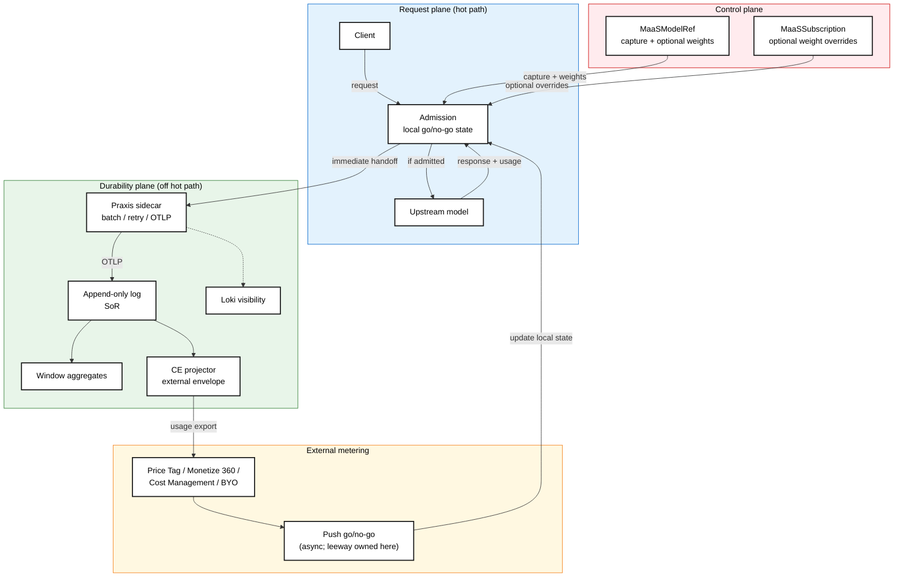

# Usage metering (TP) for AI Gateway 3.7

**Date:** 2026-10-14 (updated 2026-10-30)  
**Author:** Jamie Land (draft)  
**Owners:** AI Gateway (primary) + MaaS (collaboration)  
**Status:** Draft for RHCL / RHAI priority sheet — decisions from 2026-10-14 / 2026-10-28 narrowing + 2026-10-30 posture shift (no CRD budget; external meter owns cost + go/no-go)  
**Pattern:** RHCL Release Priority Sheet one-pagers (TokenRateLimitPolicy GA, MCP Gateway Console Plugin)  
**Planning action:** AI Gateway Planning Day 1 — coordinate Ashton Watkins (UX) + Alex Snaps (tech)

---

## Summary

Field customers want to **track and manage AI spend from token (and related) usage**, with peer-shaped expectations from products such as [OpenRouter](https://openrouter.ai/docs/faq), [LiteLLM](https://docs.litellm.ai/docs/proxy/users), and [Bifrost](https://docs.getbifrost.ai/features/governance/budget-and-limits).

For **AI Gateway / RHOAI 3.7**, AI Gateway, Praxis, Observability, MaaS, and UI need a **usage-metering TP** that is scoped to what we can ship this release, still **modular** enough to grow (more model APIs, external meters, later spend control), and **opinionated where it helps** (default capture profiles, optional weights on MaaS objects) without painting us into a corner.

**3.7 posture (locked direction):**

1. **Highest priority — accurate usage reporting.** Capture and emit native token-type (and related) breakdowns so FinOps / metering systems can rate and allocate spend. This is the TP Must.
2. **Weights on MaaS objects (optional).** Per-billable-unit **weights** (not billed prices) travel with telemetry for observability and may feed **weighted rate-limit** math. They are **not** a currency ledger and are **not** the source of truth for invoice cost.
3. **No budget / allotment / wallet on the MaaS CRD.** Cost calculation, wallets, and spend caps live in an **external metering system**. That system ultimately provides the **go / no-go** signal consumed by the gateway admission path.
4. **Export + push talk-back.** We **export** usage (OTel / Loki in-cluster; CloudEvents for external integration). External meters **push** entitlement state into the gateway — we do **not** call out on every inference. Push must be as fast as we can make it; some **lag** between true cost and cutoff is inherent, and the **metering system decides leeway** (e.g. Monetize 360’s minimum ~$10 wallet before cut-off is meaningful).
5. **Integration targets (first pass).** Design and dogfood toward **Price Tag / EnMaaS** and **Monetize 360**; explore **Red Hat Cost Management** if we can get a commitment. Publish a portable CloudEvents contract; live connector readiness is not a silent TP merge gate.

Working control-layer sketch (non-normative): [subscription-usage-weights-and-capture.md](subscription-usage-weights-and-capture.md) ([PR #1740](https://github.com/opendatahub-io/models-as-a-service/pull/1740)). Customer capture notes: [usage-metering-customer-requirements.md](usage-metering-customer-requirements.md).

### Definitions

| Term | Meaning |
| :---- | :---- |
| **Stable unit** | The dimensionless **baseline** that weights are expressed against. The platform does **not** require a currency or a fixed physical meaning. Operators decide what “1” means (e.g. cheapest input token on a reference model, or a private money-equivalent micro-unit). Everything else is measured **relative to that baseline**. The term is documentation / product language — **not** a CRD field. |
| **Weight** | A multiplier per **billable unit** (token type or other usage mode) relative to the **stable unit**. Used for observability (weighted usage in telemetry) and optionally for **rate-limit** calculations. **Not** invoice price; external meters own true cost. |
| **Billable unit** | A named usage dimension captured from the inference response (e.g. `prompt`, `output`, `cached`, `reasoning`, or non-token modes). |
| **Usage capture profile** | Declares which billable units to read from response `usage` (built-in name, ConfigMap, or inline on `MaaSModelRef`). |
| **Go / no-go** | Entitlement decision from an **external metering system**, pushed into local gateway enforcement. Admit checks local state only — no per-request outbound to the meter. |
| **Leeway** | Overrun / lag tolerance the **external meter** chooses (wallet floors, batch windows, SLA). Gateway pushes updates as fast as practical; the meter owns how much spend may occur before cut-off. |

### Design principles

1. **Scope to 3.7** — ship accurate emit + export + a clear seam for external go/no-go; document known limits rather than over-promising a built-in billing product.
2. **Reuse before invent** — OTel, Loki (default visibility), gateway in-proxy path, existing MaaS CRs — not a parallel billing ledger or CRD wallet.
3. **UX on MaaS objects** — capture and optional weights surface through `MaaSModelRef` / `MaaSSubscription` (and portal), not only raw kube YAML for power users.
4. **Opinionated defaults, flexible escape hatches** — built-in usage profiles and optional weights first; ConfigMap / inline capture and optional expressions when needed.
5. **Alerts, metrics, and UI** — operators and end users can see usage; spend remaining / cut-off UX is owned with the external meter (+ whatever local go/no-go state we mirror).
6. **Export without hot-path coupling** — external integration uses CloudEvents derived from the durable plane; admit never waits on external sinks. Talk-back is **push into** the gateway, not pull on admit.
7. **Do not duplicate the meter’s ledger** — no `budgetPolicy` / period allotment / wallet fields on MaaS CRs. Weights ≠ cost-of-record.

### Stakeholder requirements (must inform 3.7)

1. **Multi-type usage capture** — input / output / cache / reasoning (and similar) as first-class units, not a single collapsed counter. Day-1 focus can be OpenAI Chat Completions–compatible (and Anthropic Messages–shaped) paths; the control layer must stay extensible via profiles.
2. **Accurate report first** — raw token-type counts are always emitted when present. Optional weights enrich telemetry; absence of weights must not suppress emit.
3. **Attribution** — usage events attributed to authenticated principal + subscription (v1 working lean), with model / provider / timestamp, so external systems can rate and allocate. Principal includes humans and agents. API key is not a v1 attribution key.
4. **Observability** — OOTB path to ship and display usage (Loki default visibility); CloudEvents for external meters. Log/showback alone is not the whole story once go/no-go lands, but **emit quality is the 3.7 priority**.
5. **External meter owns cost + cut-off** — Price Tag, Monetize 360, and (if committed) Cost Management calculate cost and decide when to revoke entitlement. Gateway applies pushed go/no-go as quickly as the push path allows; lag and leeway are explicit.
6. **Keep metering separate from QoS** — token rate limiting remains its own policy. Weights may later inform weighted QoS math without mutating `tokenRateLimits` into a FinOps wallet.

---

## User stories

### Must for usage metering / design

1. As a platform engineer, I want the gateway to emit per-request usage (via the agreed telemetry path) with a native token-type breakdown for **token-based** responses (not a single collapsed counter), using extensible fields shaped by capture profiles (e.g. input / output / cached / reasoning for chat-shaped APIs), so that different token-based model APIs can report their native usage without forcing one fixed field set on every backend. **Raw token-type counts are always emitted when present on the response** — they do **not** depend on weights being configured.

2. As a platform engineer, I want optional **weights** per billable unit (and per model), expressed relative to a **stable unit**, so observability can show weighted usage and rate limiting can optionally consume the same weights. Weights are optional; absence of weights must not suppress the token-type emit from story 1. Weights are **not** billed currency and are **not** stored as a CRD “budget.”

3. As a FinOps integrator, I want usage events attributed to an authenticated principal + subscription (v1 working lean), with model / provider / timestamp, so that I can rate and allocate spend **in an external metering system**. Principal includes **humans and agents** (service accounts / workload identities). API key is **not** a v1 attribution key. Emit may carry richer dims when known.

4. As a platform engineer, I want usage metering kept as a separate concern from token rate limiting (QoS) — different policy fields / windows / units — while both can be evaluated on the shared in-proxy path. Configuring weights / capture must **not** require or mutate `tokenRateLimits`, and configuring QoS must **not** require or mutate metering capture.

5. As an SRE / admin, I want a **day-1** user-visible path: canonical **OTel UsageEvent** emit with **Loki as the default visibility sink**, plus other export sinks sharing that same origin — distinct from QoS rate-limit counters. Loki OOTB is a TP Must for visibility. **CloudEvents is the external-integration envelope** (derived from the durable plane — see data plane), not a replacement for OTel/Loki in-cluster visibility.

6. As a platform engineer, I want **capture paths and optional default weights on `MaaSModelRef`** (built-in / ConfigMap / inline profiles) as a 3.7 Must, with **optional weight overrides on `MaaSSubscription`**, so catalog defaults and entitlement overrides stay separate. **Capture is opt-in via ModelRef usage/capture profile** (required so the usage shape is known).

7. As an SRE / admin, I want missing or incomplete usage on a response never recorded as a successful zero — emit marked incomplete, alert / metric, and use explicitly labeled estimates when we must — so gaps stay honest.

8. As a FinOps integrator, I want a **CloudEvents export** of usage (and later lifecycle hooks as needed) derived from the durable system of record, so external meters (Price Tag, Monetize 360, Cost Management, BYO) can bind without sitting on the admit hot path.

9. As a platform engineer, I want the upgrade onto usage metering to be **seamless** — existing subscriptions, QoS `tokenRateLimits`, and inference traffic keep working without a forced cutover — so enabling metering is **additive and opt-in** (capture via ModelRef profile; weights optional).

### External spend control (direction — not a CRD budget)

*(Spend cut-off is a product outcome. The **meter** owns cost and go/no-go; the gateway applies pushed state. This is **not** `budgetPolicy` on `MaaSSubscription`.)*

10. As a tenant / budget owner, I want requests stopped when my **external** entitlement is exhausted, so spend control is not only TPM/RPM QoS. Cut-off is driven by **go/no-go pushed from the metering system** into local enforcement — not by a period allotment field on the MaaS CRD.

11. As a platform engineer, I want the **fastest practical push path** from the metering system into the gateway so lag is minimized, while accepting that some lag is inherent and that **leeway is the meter’s policy** (example: Monetize 360 requires a meaningful minimum wallet, on the order of ~$10, before cut-off semantics matter).

12. As a FinOps integrator, I want first-pass integrations aimed at **Price Tag** and **Monetize 360** (and Red Hat Cost Management if we get a commitment), bound to a published CE contract — without making any one vendor’s stack a silent merge gate for the TP.

---

### Plane-level request & data flow

**Durable plane ownership (working lean):** Praxis owns the **sidecar** (take records off the proxy immediately; batch; ship; retry; backpressure; outbound). AI Gateway owns **append-only log + window aggregates** semantics (system of record, cold-seed, archive·billing·audit). **CloudEvents** are produced by a **Gateway-owned projector** over the SoR (or derived views) — sidecar stays OTLP into the durable plane. **Loki = default visibility**; **SoR/archive = billing·audit·dispute** (invoice ≠ Loki). Implementation of the log store may still involve Observability/platform — see open questions.

**Sidecar buffer when OTLP is unhealthy:** operator knob; metering-only path may **drop** with gap signal (no local CRD budget to fail-closed against). When external go/no-go is enabled later, fail-open vs fail-closed on stale entitlement state is a separate knob owned with the talk-back design.

---

## Design locks (2026-10-30)

| Topic | Lock |
| :---- | :---- |
| 3.7 priority | **Accurate usage reporting / emit** first |
| Budget / allotment on MaaS CRD | **Out** — do not put wallets, period allotments, or `budgetPolicy` on MaaS CRs |
| Cost of record | **External metering system** |
| Go / no-go | External meter **pushes** into gateway; no per-request outbound |
| Lag / leeway | Inherent; push as fast as practical; **meter owns leeway** (e.g. Monetize 360 ~$10 wallet floor) |
| Weights | Optional on ModelRef (+ subscription override); observability + optional rate-limit math; **not** invoice price |
| Terminology | Use **stable unit** (docs) + **weight** (product/CRD language); avoid “pricing” / “budget” on the CRD |
| Capture flexibility | Keep multi-type capture profiles (built-in / ConfigMap / inline) |
| External shortlist | Price Tag + Monetize 360 first-pass; Cost Management if commitment; publish CE contract |
| CE vs OTel/Loki | CE = external envelope; OTel + Loki = in-cluster visibility |
| Hot-path handoff | Proxy → Praxis sidecar immediately; sidecar owns batch/retry/backpressure |
| CE birthplace | Gateway-owned projector from SoR (not dual-ship from sidecar) |
| Enablement | ModelRef capture profile opt-in for capture/export; weights optional |
| Incomplete usage | Never silent successful zero; mark incomplete / alert |
| Mid-stream abort | Not a 3.7 design for local token cut-off |
| Local reserve-then-settle budget | **Superseded** for CRD policy — external meter + push replaces in-product period allotment |

*Prior 2026-10-28 locks that assumed `budgetPolicy`, HTTP 402 from local allotment, and reserve/settle against a CRD budget are **reopened / superseded** by the table above. QoS 429 behavior is unchanged.*

---

## Open questions

1. **OOTB durable / aggregate implementation (ask Observability + Gateway)** — Working lean: Gateway owns SoR *semantics/contract*; Obs/platform may own log *implementation*. Open with Kevin Howell + Arik: minimum OOTB durable component for TP vs GA; who runs the store; multi-replica.

2. **AI Grid organization sync** — Emit `organization_id` best-effort when `MaaSSubscription.organization.id` is present; not a TP blocker. Sync with AI Grid Loki tenancy / QGUID labeling. Related: [RHAIRFE-3694](https://issues.redhat.com/browse/RHAIRFE-3694), [RHAISTRAT-2998](https://issues.redhat.com/browse/RHAISTRAT-2998), [RHAI-8068](https://issues.redhat.com/browse/RHAI-8068), [RHAI-8069](https://issues.redhat.com/browse/RHAI-8069), parent [RHAISTRAT-2875](https://issues.redhat.com/browse/RHAISTRAT-2875).

3. **Attribution / counter key for emit** — Working lean is principal + subscription (agents as first-class principals). Needs more discussion before freeze. Related: [RHAISTRAT-1549](https://issues.redhat.com/browse/RHAISTRAT-1549), [RHAIRFE-3644](https://issues.redhat.com/browse/RHAIRFE-3644), [RHOAIENG-97658](https://issues.redhat.com/browse/RHOAIENG-97658) / [RHOAIENG-97656](https://issues.redhat.com/browse/RHOAIENG-97656), [RHAIRFE-3691](https://issues.redhat.com/browse/RHAIRFE-3691).

4. **Quality of data bars** — TP: honest gaps; no silent zero as success. Still open: exact numeric bars (gap rate) for TP vs later chargeback.

5. **External talk-back push contract** — Payload shape, correlation identity, freshness SLA, and fail-open vs fail-closed when push is stale. Design for field stability in CE/SoR now; freeze the push API with the first integration.

6. **How fast can we push?** — Concrete latency budget from meter decision → local admit state (and how Monetize 360 / Price Tag notify).

7. **Weight schema** — Field name (`weights` vs reuse/replace `billingRate.perToken`); per-unit vs per-1K; optional `weightExpr` for overlap (OpenAI cache ⊂ prompt); display of stable-unit-weighted usage in UI.

8. **Weighted rate limiting** — Whether 3.7 consumes weights for QoS math or only emits them for later; keep QoS policy surface separate either way.

9. **Kuadrant → future path (3.6 → 3.7)** — Migration plan for existing token / rate-limit state when moving toward Praxis-shaped path. Redis↔Valkey risk.

10. **PM: integration commitments** — Confirm Price Tag + Monetize 360 dogfood; Cost Management commitment yes/no.

11. **Deny response shape when go/no-go is deny** — Prefer distinct from QoS **429** (prior lean was **402** + machine-readable code); reconfirm once push talk-back lands.

---

## Customer requirements (working)

Captured customer needs for **per-token-type capture** and optional **weights** live in [usage-metering-customer-requirements.md](usage-metering-customer-requirements.md). Use that note when refining the control-layer proposal; keep this one-pager as the TP summary.

---

## Out of scope (explicit)

- **Billing product** — invoices, payment processing, AR, Stripe/Zuora as Red Hat-owned flows. We offboard billing; we provide usage export + optional weights + a seam for external go/no-go.
- **Budget / wallet / period allotment on MaaS CRs** — including `budgetPolicy`, drain/rollover, and CRD-owned remaining-balance UX as source of truth.
- **Becoming the cost-of-record** — external meters calculate cost; local weights are not invoice prices.
- **Shipping a complete GA metering SaaS** in lockstep with the first usage metering TP (open: what minimum OOTB durable visibility we do ship — see Observability ask).
- **Live Price Tag / Monetize 360 as silent TP merge gate** — schema must be bindable; their stack readiness is not our CI gate.
- **Per-request outbound calls to external meters** — rejected (push, don’t pull on hot path).
- **Mid-stream hard cut on token count** — not a 3.7 local design.
- **Make access visible to users** (discoverable effective model set / catalog) — out of scope for this one-pager; cover via UI (MaaS portal / AI Gateway UX).

---

## Dependencies

| Dependency | Notes |
| :---- | :---- |
| Praxis / AI Gateway filters | Emit on hot path; Praxis sidecar for durable handoff; later local go/no-go state from push |
| OTel (canonical UsageEvent / logs) | In-cluster visibility path; Loki default sink |
| CloudEvents projector | External-integration envelope from SoR (Gateway-owned) |
| Durable path / SoR | Append-only + aggregates; ownership lean Gateway semantics / Obs impl TBD |
| AI Grid | `organization.id` ↔ `organization_id` / grid_tenant telemetry sync |
| TokenRateLimitPolicy / Limitador (or successor QoS path) | Remains QoS; optional future consumer of weights |
| MaaS | `MaaSModelRef` capture + optional weights; `MaaSSubscription` optional weight overrides; portal/API |
| External meters | Price Tag, Monetize 360; Cost Management if committed — cost + go/no-go |
| UX (Ashton) | How usage / weights / external entitlement state is surfaced to consumers |
| Kuadrant / Limitador (current QoS) | 3.6→3.7 migration source — see open question |

---

## Related tickets & sources

- [RHAIGW-386](https://issues.redhat.com/browse/RHAIGW-386) — AI Gateway metering  
- [RHAISTRAT-1919](https://issues.redhat.com/browse/RHAISTRAT-1919) / [RHAISTRAT-1802](https://issues.redhat.com/browse/RHAISTRAT-1802) — 3.5 DP  
- [RHAIRFE-3078](https://issues.redhat.com/browse/RHAIRFE-3078) — metering-to-billing (broader; billing offboarded from this one-pager)  
- Price Tag / EnMaaS / Monetize 360 — integration targets  
- [RHAIRFE-3694](https://issues.redhat.com/browse/RHAIRFE-3694) / [RHAISTRAT-2998](https://issues.redhat.com/browse/RHAISTRAT-2998) — org admin/end-user token usage via Loki (AI Grid)  
- [RHAI-8068](https://issues.redhat.com/browse/RHAI-8068) / [RHAI-8069](https://issues.redhat.com/browse/RHAI-8069) — grid tenant label in metrics / usage logs  
- [RHAISTRAT-1549](https://issues.redhat.com/browse/RHAISTRAT-1549) — per-model subscription context and token limits  
- [RHAIRFE-3644](https://issues.redhat.com/browse/RHAIRFE-3644) — tenant-level token quota  
- [RHAIRFE-3691](https://issues.redhat.com/browse/RHAIRFE-3691) — application (service account) identity for MaaS  
- Design: MaaS / Praxis Metering — 3.7  
- Field: 2026-09-23, 2026-10-13  
- Positioning: MaaS Market Positioning — Sept 2026  
- Captured Requirements from EnMaaS  
- Local control-layer draft: [opendatahub-io/models-as-a-service PR \#1740](https://github.com/opendatahub-io/models-as-a-service/pull/1740) (usage capture + weights)  
- Customer requirements: [usage-metering-customer-requirements.md](usage-metering-customer-requirements.md)

---

## Field feedback

Scenario raised (employer-funded prepaid balance on a key; agent spends to zero; next request must be refused with a clear out-of-funds signal so the agent stops and the user tops up). Capture points and working answers for design follow-up:

1. **Admit / prepaid** — **Not** a period allotment on `MaaSSubscription`. Prepaid / wallet / cut-off lives in the **external metering system**, which **pushes go/no-go** into the gateway. Local CRD budgets are explicitly rejected for this reason (avoid divergent ledgers vs Cost Management / Monetize 360 / Price Tag).

2. **Deny response shape** — Prefer distinct from QoS **429** when entitlement is exhausted (prior lean **402** + machine-readable code). Reconfirm with the first push talk-back design.

3. **Lag / overrun** — Accepted. Push entitlement state as fast as practical; the meter chooses leeway (Monetize 360-style minimum wallet is the working example). We do **not** try to eliminate lag by duplicating cost math on the CRD.

4. **Where the balance lives** — External meter. Gateway holds **mirrored go/no-go** (and optionally last-known entitlement metadata), not a MaaS-owned remaining-balance DB.

5. **Access after top-up** — Meter credits the wallet / entitlement and pushes go again; gateway admits once local state updates. No subscription “raise allotment” CRD workflow as the primary path.
